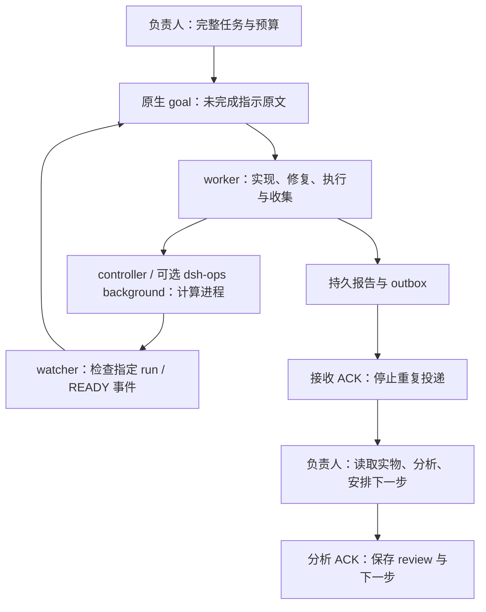

# 推荐工作方式：整包负责、原生 goal、事件接续

本指南把长期多 worker 任务与短时咨询分开。推荐由一个负责人定义目标、预算和验收条件，执行者负责完整实施、普通修复、运行、监控和收集；负责人收到结果后独立分析并安排下一包。它不要求某个固定模型，也不要求每次工具错误都征询负责人。

## 1. 各层分别负责什么



|层|职责|不能替代什么|
|---|---|---|
|native goal|保存完整指示，跨轮读取，CAS 修改|计算托管、结果验收|
|checkpoint|当前 job/run、阶段、产物、待分析事项|完整未完成指示|
|controller|计算队列、资源分配、退出状态、断点|负责人科学判断|
|watcher|程序检查事件，必要时唤醒；等待时无 LLM 轮询|计算正确性、额度恢复|
|outbox/ACK|持久投递、去重、区分收到和分析完成|读取报告并验证结论|
|可选额度适配器|读取正式额度/可用性，阻塞或允许投递|绕过拒绝、购买 reset|

DSH 的 goal 服务保存目标，goal-round-driver 才负责自动续轮。只有目标存在，并不证明新轮已经开始；`resume` 回执也只是请求被接纳。恢复时检查 goal 的 id/revision/phase/activation/roundsStarted，再核对实际计算收据。

## 2. 一次派完整包，避免来回接力

给执行者的指示应包含：问题与交付物、输入/输出路径、预算、允许修改的范围、有效性要求、复用产物、事件等待条件、何时必须升级给负责人。以下文字可作为模板：

> 请把以下完整指示保存在原生 goal 中，并设立多步任务直至整包完成。中途收到新指示时，保留全部未完成旧要求后追加，不用一条聊天排队消息代替 goal。请自主处理已有授权内的普通实现、工具、路径和环境故障；真实额度/审批拒绝不可绕过。普通进度写 checkpoint，实质技术/科学矛盾或无法解决的阻塞立即报告。所有可独立工作做完、确实依赖计算时，登记具体事件后休眠；不要为空 goal 续轮而反复查询。完成后先保存报告并持久登记通知，再结束；负责人分析前保持待分析状态。

新指令直接编辑原生 goal，使用稳定 instruction ID、revision CAS 和读回确认。相同 ID/相同内容幂等；相同 ID/不同内容拒绝。超时可能已经执行，不盲目重发。完成验收后才归档旧要求；未完成原文不能被摘要替代。

无需追求“更强模型做每一步”。负责人集中处理问题定义、模型/方法变化、结果解释和下一包；执行者整包负责普通操作与修复。总 token/轮数、准备耗时、修复次数和漏项，比单个工具返回更适合作为效率指标。没有通用固定节省比例。

## 3. 已实现的通用 CLI

`workflow.mjs` 是可选入口，面向已存在、明确登记的 DSH Web Session。旧 `bridge.mjs` 咨询循环继续保留。**同一 Session 只能由一个工作流驱动**；不要让旧协调器和新 CLI 同时调度同一 worker。

复制 `examples/workflow.config.json` 为本地 `workflow.local.json`，填写实际 workspace、stateDir、worker 名和 sessionId。相对路径以配置文件目录为准。`autoResumeOwnedGoals=true` 允许对本工作流拥有的 active/disarmed 目标每个未变化 revision 尝试一次恢复；显式暂停/blocked 不自动解除。

```powershell
node workflow.mjs dispatch --config workflow.local.json --worker worker-1 --id package-001 --file task.md
node workflow.mjs inspect --config workflow.local.json
```

`inspect` 默认只返回紧凑目标状态和待分析结果；确需完整目标时加 `--full`。Web RPC 只连接 loopback，复用当前用户的 BrowserAuth 凭据，凭据只在进程内处理，不写配置或日志。此适配器已对本机现有 goal 做只读验证；DSH API/认证仍是版本相关接口，升级后先用 `inspect` 检查，不猜参数或关闭认证。

执行者没有独立可做的工作后，调用：

```powershell
node workflow.mjs wait --config workflow.local.json --worker worker-1 --job package-001 --file results/READY.json --kind created
```

如果 READY 已存在，不会先暂停。若等待可变运行状态，用 `--kind terminal --run-id <实际run_id>`；只在匹配 run_id 的 COMPLETE/FAILED/CANCELLED 状态唤醒，心跳变化不唤醒。FAILED 表示需要处理，不等于验收通过。依赖文件路径必须留在 workspace 内。

```powershell
node workflow.mjs watch --config workflow.local.json --interval-ms 30000
# Windows 隐藏运行；返回 PID、启动时间与日志位置：
./start-workflow-watcher.ps1 -Config ./workflow.local.json
```

一个 stateDir 只运行一个 watcher；多个 worker 的检查并行。watcher 只在状态变化时输出。它不会执行原子模拟、占满 GPU、杀其它进程或为每个轮询调用模型。goal 已完成、被替换、人工暂停或真实 blocked 时保持其状态。

## 4. 完成通知是交付的一部分

报告至少包含 `job_id/session_id/goal_id/event/summary`，完整证据保存在 workspace。完成时：

```powershell
node workflow.mjs publish --config workflow.local.json --worker worker-1 --job package-001 --event complete_v1 --file reports/complete_v1.json
```

即使消息入口不可用，也先落持久 outbox。相同事件内容不可修改，修正用 complete_v2。可在 worker 配置中增加 `report: {"jobId":"package-001","event":"complete_v1","path":"reports/complete_v1.json"}`：原生 goal 完成后，watcher 会对匹配该 goal/session 的报告补登记；报告缺失则显示 REPORT_MISSING，不伪造已交付或重新启动已完成任务。

回报路径和简短摘要进入通知，不复制完整日志/历史对话。负责人收到后先执行接收 ACK，独立读取报告、分析结果并落实下一步后再执行分析 ACK：

```powershell
node workflow.mjs ack --config workflow.local.json --id <deliveryId>
node workflow.mjs ack --config workflow.local.json --id <deliveryId> --analyzed --review reviews/result.md --next "执行已定义的下一包"
```

`ACCEPTED` 只是传输接纳，`RECEIVED` 只是收到；二者仍为 analysis PENDING。发送回执晚到不能覆盖更强的接收/分析 ACK。投递结果不确定时保留 UNCERTAIN/SENDING，不因过了几分钟就重放原消息；明确 NOT_SENT 才能自动重试。正式 DENIED 保留等待，不换账号/模型/通道绕过拒绝。

## 5. 与 Codex 原生消息入口连接

本版不硬编码本机私有管道、线程身份或安装目录，也不随包复制官方插件。通过本地 `deliveryAdapter` 接入正式可用的消息入口：

```json
{
  "deliveryAdapter": {"command": ["node", "C:/local/codex-delivery-adapter.mjs"], "timeoutMs": 30000},
  "analysisNoticeAfterMs": 900000
}
```

适配器从 stdin 读取一个 JSON：`operation=probe` 返回 `{"allowed":true}`，或 `{"allowed":false,"reason":"..."}`；正式额度/审批/可用性不明时不能返回 true。`operation=send` 接收 deliveryId、jobId、event、reportPath、summary，返回 `{"status":"ACCEPTED"}` 等明确状态。只在确认尚未发送时返回 NOT_SENT，超时/发出后不确定返回 UNCERTAIN。允许状态为 ACCEPTED、RECEIVED、NOT_SENT、DENIED、UNCERTAIN。不要返回伪造的“已分析”。适配器用 argv 启动，shell=false、windowsHide=true；超时只终止该适配器子进程，不结束研究计算。

没有配置适配器时，CLI 仍可完整管理 DSH goal 和持久 outbox，但**不会自动发到 Codex**。本版没有凭空提供通用的官方 Desktop 私有管道适配器。原项目现有额度 keeper/已验证正式消息入口可以作为部署端后端，接入前做一个真实双向回执验证。

可选分析提醒只发一条独立 ANALYSIS_NOTICE，引用原结果，绝不重放原任务；已分析即抑制，原传输状态保留。额度阻塞期间尚未发送的排队时间，不算留给负责人的分析时间。提醒本身发出后不确定也不循环重发，状态留在 inspect 中。未经真实宿主验证，不能声称任意重启/卡住场景必然自动恢复。

## 6. goal 内容增长后的压缩

只在本工作流拥有的 WAITING/paused 边界压缩。用 `compact --file plan.json` 提交明确 goalId/revision、新 objective、`acceptedCompleted:[{"instructionId":"...","reviewPath":"reviews/accepted.md"}]` 和 `pendingInstructions:["..."]`。所有登记要求必须属于已验收或待完成集合；待完成指示的 marker+原文必须完整保留。旧 goal 及验收依据归档到 history，更新 CAS 后再次读回。并发新指令或人工修改会使过期 revision 失败，不覆盖。

## 7. dsh-ops、并行和恢复

本机 0.3.0 的审查发现：PTC/文件工具能减少上下文和 shell 错误，但后台状态读取不是主动唤醒；插件内存任务归属、短期结果缓存与长期证据不同。这个观察有版本边界，不能泛称以后版本都如此。采用 dsh-ops 执行/筛选结果，仍保留 goal、controller、watcher 与持久证据。不要依赖 24h 缓存引用保存唯一结果。

多 worker 按职责和写入路径分工，不机械一人一块 CPU。计算由共享队列/资源租约分配空闲核、GPU 和 RAM，限制嵌套 BLAS 过订阅；并行数据、实现和审核中无依赖的工作，不等整包完成才启动可独立部分。工具预检只核新增具体风险，复用已验收基线/输入/输出，不反复全库 hash 或重算成功任务。后处理失败从已存权重/预测恢复，不重训有效模型。

恢复先读当前 goal、单一 checkpoint、结果与真实进程收据；不要让旧提示复活已结束阶段。检查 run_id、PID、启动时间和命令行，网络读取失败不能等同计算失败。普通执行器启动错误与真实权限拒绝分开；前者按已授权正式途径修复，后者保留阻塞，不绕过。

模型 capacity、usage limit、无活动 turn、桌面 UI 假思考是不同故障。官方 `turn/steer` 需要活动 turn，空闲线程使用正确的恢复/新轮入口；不自动复制原科学任务。插件与桌面应用版本不匹配曾使所有调用在入口失败，应先检查工具列表/只读调用和应用配套插件，而不是冒用身份或修改官方代码。整个桌面应用重启可能影响其它对话，本通用版不自动执行这类操作。

## 8. 验证边界

离线回归覆盖指示保留/CAS、重复与不确定投递、休眠/重启接续、人工暂停、run身份、补登记、ACK竞争和压缩漏项；原咨询/MCP握手测试继续运行。实际 DSH Web `goals/get` 已只读成功验证。没有启动新模型/worker来制造全链测试，也未替换正在运行的研究 watcher/keeper。部署前用独立短任务检查：真实 goal→等待→事件唤醒、报告→消息接收→分析ACK、服务中断与进程重启后的认领。

Codex 协议依据：[官方 App Server 文档](https://learn.chatgpt.com/docs/app-server)。本项目使用的 DSH goals 是另一套宿主接口，不与 Codex goal/turn API 混用。记录代码、离线测试、真实只读、真实双向闭环和未验证边界时应分别陈述。
